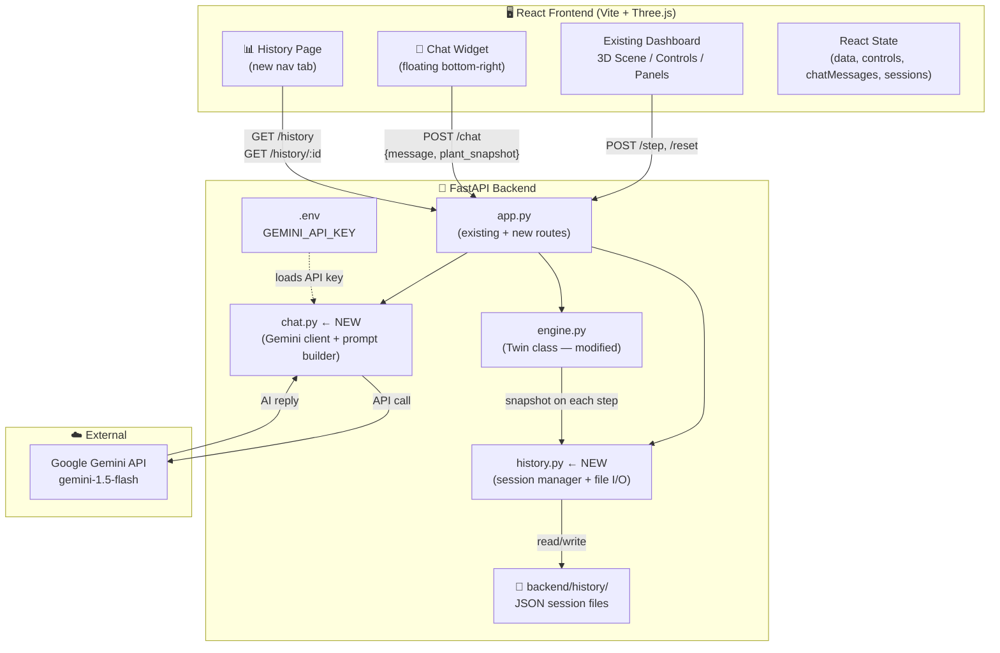

# Implementation Plan — AI Chatbot + Simulation History

## Goal

Add two major features to the STP Digital Twin:

1. **AI Chatbot** — A Gemini-powered plant operations assistant that answers questions using live simulation context
2. **Simulation History** — Automatic recording of full session data from Play → Reset, with a dedicated analytics page

---

## System Architecture (After Implementation)



---

## Proposed Changes

### Component 1: Backend Core Modifications

---

#### [MODIFY] [engine.py](file:///Users/mobaisonoinam/Downloads/stp_command_center/backend/engine.py)

**What changes:**
- Add `self.session_history = []` in `reset()` — a list that stores **every** snapshot (not capped at 360 like the existing `self.history`)
- On each `step()`, append the full snapshot + controls used to `self.session_history`
- Add `self.session_start_time` to record when the session began

```python
# In reset():
self.session_history = []
self.session_start_time = None

# At the end of step():
if self.session_start_time is None:
    self.session_start_time = datetime.utcnow().isoformat()

self.session_history.append({
    'time_s': round(self.elapsed, 2),
    'controls': asdict(c),
    'snapshot': {
        'flows_gpm': self.flows,
        'alerts': self.alerts,
        'energy_kwh': round(self.energy, 4),
        'membrane_tmp_kpa': dict(self.tmp),
        'effluent': self.quality('outlet'),
        'tank_levels': {s.key: round(100 * self.volume[s.key] / s.cap, 2) for s in VESSELS}
    }
})
```

> [!NOTE]
> The existing `self.history` (capped at 360 for the live MiniTrend charts) is **untouched**. The new `session_history` is a separate, uncapped list for persistent storage.

---

#### [NEW] [history.py](file:///Users/mobaisonoinam/Downloads/stp_command_center/backend/history.py)

**Purpose:** Manages saving/loading simulation session files.

```python
# Responsibilities:
# 1. save_session(session_data) → writes JSON file to backend/history/
# 2. list_sessions() → returns metadata of all saved sessions
# 3. get_session(session_id) → reads and returns a full session
# 4. delete_session(session_id) → removes a session file
# 5. export_csv(session_id) → converts session to CSV format
```

**Storage format** — one JSON file per session:

```json
{
    "session_id": "20231123_183500",
    "started_at": "2023-11-23T18:35:00Z",
    "ended_at": "2023-11-23T19:12:45Z",
    "total_steps": 245,
    "total_simulated_seconds": 14700,
    "final_effluent": {
        "cod": 4.8, "bod": 2.1, "tss": 0.9,
        "nh4": 1.2, "no3": 8.4
    },
    "total_energy_kwh": 312.5,
    "total_alerts_triggered": 3,
    "steps": [
        {
            "time_s": 60,
            "controls": {"inlet_gpm": 1900, ...},
            "snapshot": {
                "flows_gpm": {...},
                "alerts": [...],
                "energy_kwh": 1.2,
                "effluent": {"cod": 42.1, ...},
                "tank_levels": {"lift": 50.2, ...}
            }
        }
    ]
}
```

**File naming:** `backend/history/{YYYYMMDD_HHMMSS}.json`
**Directory:** Auto-created with `os.makedirs('history', exist_ok=True)`

---

#### [NEW] [chat.py](file:///Users/mobaisonoinam/Downloads/stp_command_center/backend/chat.py)

**Purpose:** Gemini API client + dynamic system prompt builder.

**Key design:** The system prompt is **rebuilt on every request** with the latest plant metrics so the AI always has current context.

```python
# Pseudocode structure:

import google.generativeai as genai
from dotenv import load_dotenv

class STPChatbot:
    def __init__(self):
        load_dotenv()
        genai.configure(api_key=os.getenv('GEMINI_API_KEY'))
        self.model = genai.GenerativeModel('gemini-1.5-flash')

    def build_system_prompt(self, snapshot: dict) -> str:
        """Builds context-aware system prompt with live plant data."""
        return f"""
You are an expert STP (Sewage Treatment Plant) operations assistant
monitoring a BNR–MBR digital twin simulation.

CURRENT LIVE PLANT DATA:
━━━━━━━━━━━━━━━━━━━━━━━
• Treated Flow:     {snapshot['flows_gpm'].get('treated_out', 0):.0f} GPM
• Effluent COD:     {snapshot['tanks']['outlet']['quality']['cod']:.1f} mg/L (target: 5)
• Effluent BOD:     {snapshot['tanks']['outlet']['quality']['bod']:.1f} mg/L
• Effluent TSS:     {snapshot['tanks']['outlet']['quality']['tss']:.1f} mg/L (target: 2)
• Effluent NH₄-N:   {snapshot['tanks']['outlet']['quality']['nh4']:.1f} mg/L
• Energy:           {snapshot['energy_kwh']:.1f} kWh
• MBR TMP (Train 1): {snapshot['membrane_tmp_kpa']['1']:.1f} kPa
• Active Alarms:    {snapshot['alerts'] or 'None'}
• Simulation Time:  {snapshot['time_s']/3600:.2f} hours

PLANT CONFIGURATION:
• 4 parallel BNR trains (Anaerobic → Pre-Anoxic → Aerobic → Post-Anoxic)
• 4 MBR membrane tanks
• 2 EQ basins, Lift station, Coarse/Fine screens, Grit removal
• Design capacity: 7.5 MGD, Outlet reference: 3.1 MGD

INSTRUCTIONS:
• Answer concisely and actionably
• Reference actual live values in your answers
• When suggesting control changes, name the specific slider/toggle
• Flag any concerning values based on typical wastewater standards
• This is a simulation — remind user if they ask about real compliance
"""

    async def ask(self, message: str, history: list, snapshot: dict) -> str:
        system_prompt = self.build_system_prompt(snapshot)
        # Build conversation with system context + history + new message
        chat = self.model.start_chat(history=[...])
        response = await chat.send_message_async(message)
        return response.text
```

---

#### [MODIFY] [app.py](file:///Users/mobaisonoinam/Downloads/stp_command_center/backend/app.py)

**New routes added:**

| Method | Route | Purpose |
|---|---|---|
| `POST` | `/chat` | Send message to AI chatbot |
| `GET` | `/history` | List all saved sessions |
| `GET` | `/history/{id}` | Get full session data |
| `GET` | `/history/{id}/download` | Download session as CSV |
| `DELETE` | `/history/{id}` | Delete a session |

**Modified routes:**

| Route | Change |
|---|---|
| `POST /reset` | Now calls `history.save_session()` before resetting (saves the session that just ended) |

```python
# New /chat endpoint:
class ChatRequest(BaseModel):
    message: str
    history: list = []
    plant_snapshot: dict = {}

@app.post('/chat')
async def chat(req: ChatRequest):
    reply = await chatbot.ask(req.message, req.history, req.plant_snapshot)
    return {'reply': reply}

# Modified /reset:
@app.post('/reset')
def reset():
    # Save current session before resetting (if any steps were taken)
    if model.session_history:
        history_manager.save_session(model)
    return model.reset()

# New history endpoints:
@app.get('/history')
def list_sessions():
    return history_manager.list_sessions()

@app.get('/history/{session_id}')
def get_session(session_id: str):
    return history_manager.get_session(session_id)

@app.delete('/history/{session_id}')
def delete_session(session_id: str):
    return history_manager.delete_session(session_id)
```

---

#### [NEW] [.env](file:///Users/mobaisonoinam/Downloads/stp_command_center/backend/.env)

```env
GEMINI_API_KEY=your_api_key_here
```

#### [MODIFY] [requirements.txt](file:///Users/mobaisonoinam/Downloads/stp_command_center/backend/requirements.txt)

```diff
 fastapi>=0.110,<1
 pydantic>=2,<3
 uvicorn>=0.29,<1
+google-generativeai>=0.7,<2
+python-dotenv>=1.0,<2
```

---

### Component 2: Frontend — Chat Widget

---

#### [MODIFY] [main.jsx](file:///Users/mobaisonoinam/Downloads/stp_command_center/frontend/src/main.jsx)

**New state variables in `App()`:**

```javascript
const [chatOpen, setChatOpen]         = useState(false);
const [chatMessages, setChatMessages] = useState([
  { role: 'bot', text: "I'm monitoring your plant in real-time. Ask me anything about the process!" }
]);
const [chatInput, setChatInput]       = useState('');
const [chatLoading, setChatLoading]   = useState(false);
```

**New `Chatbot` component (inline in main.jsx):**

```
UI Layout:
┌──────────────────────────────────┐
│  🤖 STP ASSISTANT           ✕   │  ← glassmorphism header
├──────────────────────────────────┤
│                                  │
│  ┌─────────────────────┐         │
│  │ BOT  Welcome! I'm   │         │  ← left-aligned, dark blue bubble
│  │ monitoring your ...  │         │
│  └─────────────────────┘         │
│                                  │
│         ┌─────────────────────┐  │
│         │ USER  Why is COD    │  │  ← right-aligned, teal bubble
│         │ so high right now?  │  │
│         └─────────────────────┘  │
│                                  │
│  ┌─────────────────────┐         │
│  │ BOT  Current COD is  │         │
│  │ 32 mg/L — above the  │         │
│  │ 5 mg/L target. Try   │         │
│  │ increasing aeration. │         │
│  └─────────────────────┘         │
│                                  │
├──────────────────────────────────┤
│  [Type your question...]  [➤]   │  ← input bar
└──────────────────────────────────┘

                            💬      ← floating trigger bubble
```

**Data flow:**

```javascript
async function sendChat() {
    if (!chatInput.trim() || chatLoading) return;
    const userMsg = chatInput.trim();
    setChatMessages(prev => [...prev, { role: 'user', text: userMsg }]);
    setChatInput('');
    setChatLoading(true);
    try {
        const res = await fetch(`${API}/chat`, {
            method: 'POST',
            headers: { 'Content-Type': 'application/json' },
            body: JSON.stringify({
                message: userMsg,
                history: chatMessages.slice(-10),  // last 10 for context
                plant_snapshot: data               // ← LIVE simulation state
            })
        });
        const { reply } = await res.json();
        setChatMessages(prev => [...prev, { role: 'bot', text: reply }]);
    } catch (e) {
        setChatMessages(prev => [...prev, { role: 'bot', text: 'Connection error. Is the backend running?' }]);
    }
    setChatLoading(false);
}
```

---

### Component 3: Frontend — History / Analytics Page

---

#### [MODIFY] [main.jsx](file:///Users/mobaisonoinam/Downloads/stp_command_center/frontend/src/main.jsx)

**New nav tab added to the header:**

```javascript
// Add to the nav array:
{ key: 'history', name: 'HISTORY', icon: Clock3 }
```

**New `HistoryPage` component (inline in main.jsx):**

```
UI Layout:
┌────────────────────────────────────────────────────────┐
│  📊 SIMULATION HISTORY                        CLOSE ✕  │
├────────────────────────────────────────────────────────┤
│                                                        │
│  ┌─ SESSION LIST ────────────────────────────────────┐ │
│  │                                                    │ │
│  │  ┌────────────────────────────────────────────┐   │ │
│  │  │ 📅 2023-11-23 18:35:00                     │   │ │
│  │  │ Duration: 37 min · 245 steps               │   │ │
│  │  │ Final COD: 4.8 mg/L · Energy: 312 kWh     │   │ │
│  │  │ [VIEW]  [DOWNLOAD CSV]  [🗑️ DELETE]        │   │ │
│  │  └────────────────────────────────────────────┘   │ │
│  │                                                    │ │
│  │  ┌────────────────────────────────────────────┐   │ │
│  │  │ 📅 2023-11-22 14:10:00                     │   │ │
│  │  │ Duration: 1h 12 min · 580 steps            │   │ │
│  │  │ ...                                         │   │ │
│  │  └────────────────────────────────────────────┘   │ │
│  └────────────────────────────────────────────────────┘ │
│                                                        │
│  ┌─ SESSION DETAIL (when VIEW clicked) ──────────────┐ │
│  │                                                    │ │
│  │  EFFLUENT QUALITY OVER TIME                       │ │
│  │  ┌────────────────────────────────────────────┐   │ │
│  │  │  ~~~  COD trend  ~~~  BOD  ~~~ TSS         │   │ │
│  │  │  (reuses MiniTrend component)              │   │ │
│  │  └────────────────────────────────────────────┘   │ │
│  │                                                    │ │
│  │  ENERGY & FLOW TREND                              │ │
│  │  ┌────────────────────────────────────────────┐   │ │
│  │  │  ~~~ Energy ~~~ Flow                       │   │ │
│  │  └────────────────────────────────────────────┘   │ │
│  │                                                    │ │
│  │  ALERTS TIMELINE                                  │ │
│  │  │ 00:05  ⚠ Lift pump stopped                    │ │
│  │  │ 00:12  ⚠ Membrane air scour stopped           │ │
│  │  │ 00:18  ⚠ High membrane fouling index          │ │
│  │                                                    │ │
│  │  SESSION SUMMARY                                  │ │
│  │  ┌────┬────┬────┬────┬─────┐                     │ │
│  │  │ COD│ BOD│ TSS│ kWh│Alarm│                     │ │
│  │  │4.8 │2.1 │0.9 │312 │  3  │                     │ │
│  │  └────┴────┴────┴────┴─────┘                     │ │
│  └────────────────────────────────────────────────────┘ │
└────────────────────────────────────────────────────────┘
```

**Key behavior:**
- On mount → `GET /history` → populate session list
- Click "VIEW" → `GET /history/{id}` → render charts + summary
- Click "DOWNLOAD" → trigger browser file download
- Click "DELETE" → `DELETE /history/{id}` → refresh list

---

### Component 4: Styling

---

#### [MODIFY] [style.css](file:///Users/mobaisonoinam/Downloads/stp_command_center/frontend/src/style.css)

New CSS classes to add (matching existing dark sci-fi theme):

**Chat Widget:**
| Class | Purpose |
|---|---|
| `.chat-bubble` | Floating round trigger button — pulsing glow animation |
| `.chat-panel` | Slide-up panel — glassmorphism background, border glow |
| `.chat-panel.open` | Visible state with `transform: translateY(0)` transition |
| `.chat-header` | Panel header with title + close button |
| `.chat-body` | Scrollable message area |
| `.chat-msg.bot` | Bot bubble — left-aligned, dark blue |
| `.chat-msg.user` | User bubble — right-aligned, teal accent |
| `.chat-input-row` | Bottom input + send button |
| `.chat-typing` | Animated "●●●" typing indicator |

**History Page:**
| Class | Purpose |
|---|---|
| `.history-overlay` | Full-screen overlay (like existing `.tab-overlay`) |
| `.session-card` | Individual session card — hover glow effect |
| `.session-detail` | Expanded view with charts |
| `.session-summary` | Summary metrics grid |
| `.alert-timeline` | Vertical timeline of alerts |
| `.download-btn` | Styled download/export button |

---

## Complete File Change Summary

| File | Action | Lines Changed (est.) |
|---|---|---|
| [engine.py](file:///Users/mobaisonoinam/Downloads/stp_command_center/backend/engine.py) | MODIFY | +15 lines |
| [chat.py](file:///Users/mobaisonoinam/Downloads/stp_command_center/backend/chat.py) | **NEW** | ~80 lines |
| [history.py](file:///Users/mobaisonoinam/Downloads/stp_command_center/backend/history.py) | **NEW** | ~90 lines |
| [app.py](file:///Users/mobaisonoinam/Downloads/stp_command_center/backend/app.py) | MODIFY | +45 lines |
| [.env](file:///Users/mobaisonoinam/Downloads/stp_command_center/backend/.env) | **NEW** | 1 line |
| [requirements.txt](file:///Users/mobaisonoinam/Downloads/stp_command_center/backend/requirements.txt) | MODIFY | +2 lines |
| [main.jsx](file:///Users/mobaisonoinam/Downloads/stp_command_center/frontend/src/main.jsx) | MODIFY | +120 lines |
| [style.css](file:///Users/mobaisonoinam/Downloads/stp_command_center/frontend/src/style.css) | MODIFY | +180 lines |
| [.gitignore](file:///Users/mobaisonoinam/Downloads/stp_command_center/.gitignore) | **NEW** | 3 lines |

---

## Data Flow Diagrams

### Chat Flow

```
  USER                REACT               FASTAPI             GEMINI
   │                    │                    │                   │
   │─ types question ──▶│                    │                   │
   │                    │── POST /chat ─────▶│                   │
   │                    │   {message,        │                   │
   │                    │    snapshot: data}  │                   │
   │                    │                    │── build prompt ──▶│
   │                    │                    │   with live data   │
   │                    │                    │                   │
   │                    │                    │◀── AI response ───│
   │                    │◀── {reply} ────────│                   │
   │◀─ renders bubble ──│                    │                   │
```

### History Flow

```
  PLAY               STEP               RESET             HISTORY PAGE
   │                   │                  │                     │
   │── user clicks ──▶│                  │                     │
   │                   │── step() ──┐    │                     │
   │                   │            │    │                     │
   │                   │  append to │    │                     │
   │                   │  session   │    │                     │
   │                   │  _history  │    │                     │
   │                   │            │    │                     │
   │                   │  (repeats  │    │                     │
   │                   │   N times) │    │                     │
   │                   │◀───────────┘    │                     │
   │                   │                  │                     │
   │── user resets ─────────────────────▶│                     │
   │                                     │── save_session() ──▶│
   │                                     │   write JSON file   │
   │                                     │                     │
   │                                     │                     │── GET /history
   │                                     │                     │── GET /history/:id
   │                                     │                     │── renders charts
```

---

## Prerequisites

> [!IMPORTANT]
> **Before implementation, you need:**
> 1. A **Google Gemini API key** — get it free at [aistudio.google.com/app/apikey](https://aistudio.google.com/app/apikey)
> 2. Install the new Python dependencies: `pip install google-generativeai python-dotenv`

> [!NOTE]
> **No database required** — sessions are stored as plain JSON files in `backend/history/`. This keeps the setup simple with zero infrastructure. Can be upgraded to SQLite later if needed.

> [!TIP]
> **Throttling:** For very long simulation runs (1000+ steps), the session file could grow large (~2–5 MB). We'll add optional downsampling (record every Nth step) if file sizes become a concern.

---

## Verification Plan

### Automated Tests
```bash
cd backend
python -m unittest -v                    # existing tests still pass
python -m pytest test_chat.py -v         # new chatbot tests
python -m pytest test_history.py -v      # new history tests
```

### Manual Verification

| Test | Steps | Expected Result |
|---|---|---|
| **Chat works** | Open chat → type "What is current COD?" | Bot replies with actual COD value from simulation |
| **Chat has context** | Run simulation 5 steps → ask "Any alarms?" | Bot lists active alarms or says "none" |
| **History saves** | Play 10 steps → Reset | JSON file appears in `backend/history/` |
| **History page** | Click History tab | Session cards displayed with metadata |
| **History charts** | Click VIEW on a session | MiniTrend charts render with historical data |
| **CSV download** | Click DOWNLOAD | Browser downloads a CSV file |
| **Delete** | Click DELETE | Session removed from list and disk |
| **Multiple sessions** | Play → Reset → Play → Reset | Two separate session files created |

---

## Execution Order

| Step | Task | Depends On |
|---|---|---|
| 1 | Add `.env` with Gemini API key placeholder | — |
| 2 | Update `requirements.txt` + `pip install` | Step 1 |
| 3 | Create `backend/history.py` (session file manager) | — |
| 4 | Modify `engine.py` (add `session_history` capture) | — |
| 5 | Create `backend/chat.py` (Gemini client) | Step 2 |
| 6 | Modify `app.py` (new routes + save-on-reset) | Steps 3, 4, 5 |
| 7 | Modify `style.css` (chat + history CSS) | — |
| 8 | Modify `main.jsx` (Chat widget + History page) | Steps 6, 7 |
| 9 | Test backend (`curl` / unittest) | Step 6 |
| 10 | Test frontend (browser) | Step 8 |
